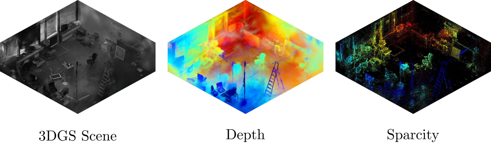

# IsoSplat



**Live app: [mateosss.github.io/isosplat](https://mateosss.github.io/isosplat)**

IsoSplat is a web viewer for 3D Gaussian Splatting scenes of rooms. It shows them in isometric
views, with cut-planes that remove walls and ceilings. You can import `.ply` splats, place
pinhole or orthographic cameras, edit with Blender-style controls, switch between gaussian,
point-cloud and depth rendering, and export clean PNG renders.

**Example project:** [droneroom.isosplat](https://syncandshare.lrz.de/getlink/fiSYCm4n3M7t8yYcvjA5pz/droneroom.isosplat)
is the scene used for the cover images above. Download it and open it in the app with **Open**
or by dropping it onto the window.

## Running

```sh
npm install
npm run dev       # http://localhost:5173
npm run build     # typecheck + production build in dist/
npm run supplementary  # offline, self-contained viewer folder (see below)
```

### Deploying to GitHub Pages

`.github/workflows/pages.yml` builds the app on every push to `main` and publishes it with
GitHub Pages (the build is uploaded as a Pages artifact, so `dist/` is never committed).
One-time setup: in the repository settings, **Pages → Source: GitHub Actions**.
The site is fully static and uses relative asset paths, so it works at `https://<user>.github.io/<repo>/`.

Built with [three.js](https://threejs.org) and [Spark](https://sparkjs.dev) (3DGS renderer).
Every cut is an oriented box: a cut-plane removes the gaussians behind it that fall inside its
rectangle (the rectangle extruded backwards), a cut-box removes what is inside it. Gaussians use a
global Spark `SplatEdit` (one BOX SDF per enabled cut, opacity 0); point clouds run the same box test
in their shader.

## Conventions

- World is **Z-up** (like Blender); the floor grid is the XY plane.
- Cameras use the three.js convention: they look down local **−Z** with **+Y** up.
  Pinhole intrinsics (fx, fy, cx, cy) are in pixels of the camera resolution, OpenCV style.
- Orthographic scale is the world size covered by the larger image side (like Blender).

## Controls

| Input | Action |
| --- | --- |
| LMB drag / RMB drag / wheel | orbit / pan / zoom (Shift+LMB also pans) |
| LMB click | select splat, camera or cut-plane (click on the plane border or arrow) |
| LMB drag on a cut-plane arrow | slide the plane along its normal (Esc cancels) |
| G / R / S | move / rotate / scale the selection (mouse must be over the viewport) |
| X / Y / Z during G/R/S | constrain to global axis; press again for local; again to clear |
| digits, `-`, Backspace | type an exact value (metres / degrees / factor) |
| Ctrl / Shift during G/R/S | snap / precision |
| LMB or Enter / RMB or Esc | confirm / cancel transform |
| F | orbit around the surface under the mouse cursor (view pans to center it) |
| ⊕ Orbit center button | orbit around the surface at the viewport center (view doesn't move) |
| Numpad . / Period, Home | frame selected / frame all splats |
| Del | delete selected |
| 1 / 3 / 7 | front / right / top view; with Ctrl (or Shift) back / left / bottom |
| 2 / 4 / 6 / 8 | orbit 15° down / left / right / up; with Ctrl: pan |
| 9 / 5 / 0 | opposite side / persp↔ortho / look from (selected or first) camera |
| Numpad + / − | zoom in / out |
| Z / ◐ Depth button | toggle depth view (jet colormap) |
| P | toggle gaussians / point cloud for every splat |
| Ctrl+S / Ctrl+Shift+S / Ctrl+O | save project / save as / open project |
| Number fields | click to type, drag horizontally to scrub (Shift fine, Ctrl snap, Esc restore) |
| W / WASD button | fly mode: WASD move, mouse look, Q/E down/up, Shift faster, wheel = base speed, Esc or left click exits |

## Projects, rendering and world

- **Projects** (`.isosplat`) are self-contained: a small header, a JSON description of the scene
  (elements, transforms, camera/cut-plane settings, world, view, WASD fly speed) and the original
  splat and trajectory files embedded byte-for-byte. In Chrome/Edge, Save writes back to the opened file; elsewhere it downloads.
  Drop a `.isosplat` file on the window to open it.
- **Render PNG** (toolbar, camera properties, or World properties) renders a clean image without
  overlays, splats sorted for the render camera, with 2× supersampling. From a camera it uses the
  camera's resolution; from the free view it uses the viewport's pixel size.
- **Cuts**: cut-planes (+ Cut) remove what is behind them within their rectangle (resize with S);
  uncheck **Bounded** to cut the whole half-space behind the plane instead (handy for far-away
  floaters; the six default planes and projects saved before rectangles existed are unbounded). Cut-boxes (+ Box) keep only
  what is inside them, or with **Invert** remove their inside and keep the rest (move / rotate /
  scale with G / R / S).
- **Minimap** (▣ Minimap, or "Preview in minimap" on a camera): a second, resizable view in the
  corner (drag its top-left corner). It works like the main view (orbit, click to select, G/R/S,
  numpad keys, F, W fly…: keys act on the view under the mouse) with its options in its ☰ menu,
  including its own overlays toggle (off by default) and "look from camera". Typical use: keep a clean camera
  preview while editing cuts in the main view.
- **World** (top of the hierarchy): background color, and an option to render PNGs with a
  transparent background.
- **Depth view** colors gaussians and point clouds by their depth along the camera's view axis with
  matplotlib's jet colormap (blue = near, red = far); a legend shows the range. The range is fitted
  automatically to the visible scene (splat bounds clipped by the cut-planes) or set manually in the
  World properties. PNG renders use the depth range of the render camera.

View keys work on the numpad and on the top-row digits. Browsers often reserve Ctrl+1…8 for
switching tabs, which is why Shift also selects the opposite view.

Drag & drop `.ply` (also `.spz`, `.splat`, `.ksplat`, `.sog`) files onto the window to import.

## Sharing scenes as an offline folder

`npm run supplementary` packs `.isosplat` projects into a folder that anyone can open by
double-clicking `index.html`: no install, no server, no internet. The code, the scenes and the
thumbnails are all inside the folder, and it works from `file://` (it makes no network requests).
It was made for anonymous paper supplementary material, but works for any offline sharing.

```
splats/
├── index.html        welcome page: title and one card per scene (thumbnail, name, size)
├── viewer.html       the viewer: this app, view-only, with the controls shown on open
├── README.txt        short instructions for whoever opens it
└── scenes/
    └── scene1.js …   scene data (must stay in scenes/ next to viewer.html)
```

The viewer can orbit, fly (W), switch perspective/ortho, show depth (Z) and point clouds (P),
toggle overlays and the minimap, and move cut-planes by dragging their arrows. It cannot edit,
save or import. Backspace returns to the welcome page.

1. **Prepare each scene** in the app and save it. The viewer opens a scene exactly as saved: the
   view and projection, the enabled cut-planes and cut-boxes, overlays, minimap, background, depth
   view, render mode, and the WASD speed (the current fly speed is saved; the mouse wheel changes
   it while flying).
2. **Write `splats.config.json`** in the repository root (git-ignored, since it usually names the
   paper):

   ```json
   {
     "title": "Paper title",
     "subtitle": "Supplementary material",
     "forbidden": ["author name", "university"],
     "scenes": [
       { "file": "isosplats/room/scene.isosplat", "label": "Room", "thumbnail": "figures/room.png" },
       { "file": "isosplats/hall/scene.isosplat", "label": "Hall" }
     ]
   }
   ```

3. **Build** with `npm run supplementary`. It writes `splats/` in about a second when every scene
   has a `thumbnail`; scenes without one get a render of their saved view, which takes a few
   minutes and needs Chrome.
4. **Check and zip**: open `splats/index.html` from disk, then `zip -r -X splats.zip splats`
   (`-X` leaves out your user and group IDs).

**Anonymity.** The output has no app name, links, original file names or PLY header comments, and
the build refuses to write anything if a page, scene or file header contains a string from
`forbidden` (put every author name and affiliation there) or a reference to this app or its
hosting. The viewer is still this public app, though: during a double-blind review, consider making
the repository and its GitHub Pages site private.

Config keys, thumbnails and the build options are described in
[supplementary/README.md](supplementary/README.md).
